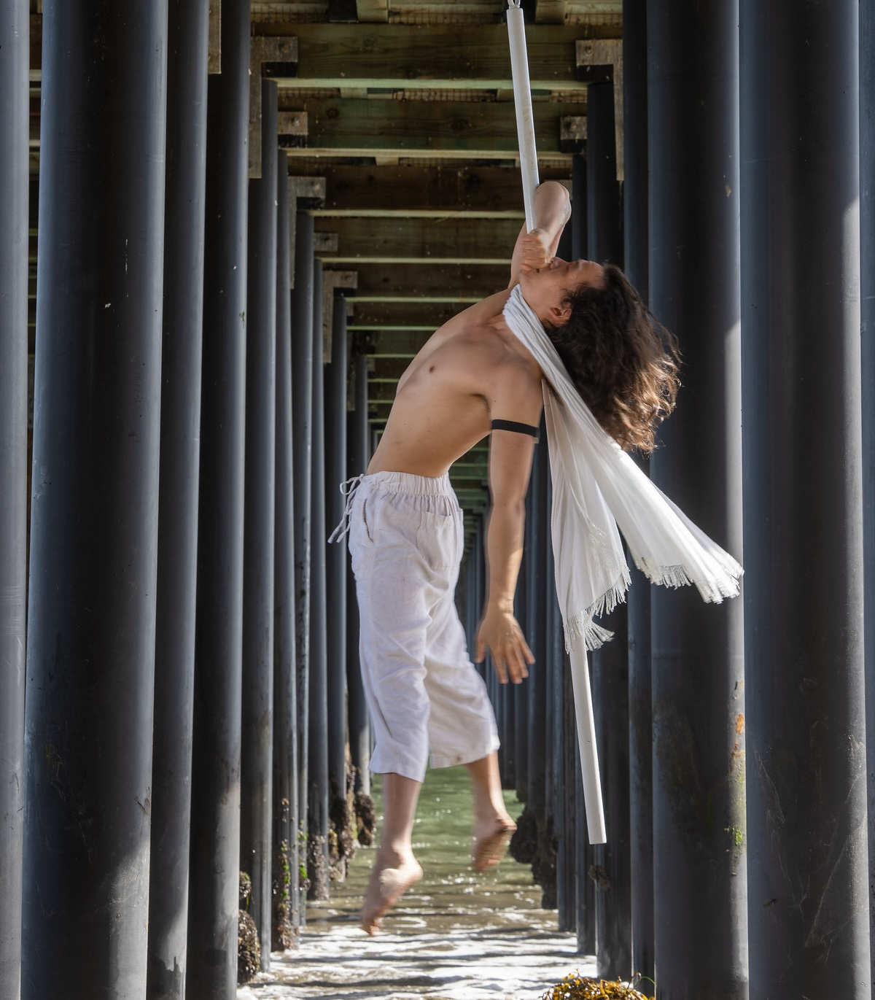

<!-- ======================== 1. HERO ======================== -->

  

    
    

  

  

    
Toca &mdash; The Kinetic Heart

    <h1 class="hero-title">Marco Chiang</h1>
    
Aerialist. Creator. Storyteller.

    <a href="mailto:marcochiangtw@gmail.com?subject=Let%27s%20Connect" class="hero-cta">Connect with Me</a>
  

  

    
  

<!-- ======================== 2. ESSENCE ======================== -->

  <h2 class="section-heading">Essence</h2>
  

    Toca moves freely, loves abundantly, creates joy, and inspires people to feel safe expressing their most authentic selves.
  

  

    Beyond the stage, I'm a community builder, content creator, and software engineer with 12+ years of experience. I embody love, generosity, and freedom.
  

<!-- ======================== 3. FIVE DIMENSIONS ======================== -->

  <h2 class="section-heading">Five Dimensions</h2>
  

    

      

        <svg viewBox="0 0 24 24" fill="none" stroke="currentColor" stroke-width="1.5" width="32" height="32"><path d="M13 2L3 14h9l-1 8 10-12h-9l1-8z" stroke-linecap="round" stroke-linejoin="round"/></svg>
      

      <h3>Movement & Mastery</h3>
      
Flying pole, aerial arts, and the endless pursuit of what the body can express through disciplined practice.

    

    

      

        <svg viewBox="0 0 24 24" fill="none" stroke="currentColor" stroke-width="1.5" width="32" height="32"><path d="M12 2a5 5 0 015 5c0 3-5 8-5 8s-5-5-5-8a5 5 0 015-5z" stroke-linecap="round" stroke-linejoin="round"/><circle cx="12" cy="7" r="1.5"/><path d="M8 21h8M12 17v4" stroke-linecap="round" stroke-linejoin="round"/></svg>
      

      <h3>Creative Expression</h3>
      
Storytelling through movement, video, writing, and every medium that bridges the gap between feeling and form.

    

    

      

        <svg viewBox="0 0 24 24" fill="none" stroke="currentColor" stroke-width="1.5" width="32" height="32"><path d="M17 21v-2a4 4 0 00-4-4H5a4 4 0 00-4 4v2" stroke-linecap="round" stroke-linejoin="round"/><circle cx="9" cy="7" r="4"/><path d="M23 21v-2a4 4 0 00-3-3.87M16 3.13a4 4 0 010 7.75" stroke-linecap="round" stroke-linejoin="round"/></svg>
      

      <h3>Human Connection</h3>
      
Building communities, fostering belonging, and creating spaces where people feel seen and inspired.

    

    

      

        <svg viewBox="0 0 24 24" fill="none" stroke="currentColor" stroke-width="1.5" width="32" height="32"><circle cx="12" cy="12" r="10"/><path d="M12 6v6l4 2" stroke-linecap="round" stroke-linejoin="round"/></svg>
      

      <h3>Intentional Living</h3>
      
Designing a life around what matters - experiences over possessions, depth over comfort, presence over performance.

    

    

      

        <svg viewBox="0 0 24 24" fill="none" stroke="currentColor" stroke-width="1.5" width="32" height="32"><path d="M20.84 4.61a5.5 5.5 0 00-7.78 0L12 5.67l-1.06-1.06a5.5 5.5 0 00-7.78 7.78l1.06 1.06L12 21.23l7.78-7.78 1.06-1.06a5.5 5.5 0 000-7.78z" stroke-linecap="round" stroke-linejoin="round"/></svg>
      

      <h3>Courage & Vulnerability</h3>
      
Leading with heart, showing up fully, and proving that strength and softness aren't opposites - they're partners.

    

  

<!-- ======================== 4. PERFORMANCE / BOOKING ======================== -->

  <h2 class="section-heading">Performance</h2>
  

    I specialize in <strong>flying pole</strong> - a discipline that combines the raw power of pole with the freedom of aerial arts. From underneath ocean piers to festival main stages, I bring performances that are athletic, emotional, and unforgettable.
  

  

    

      <h3>Available for Bookings</h3>
      
Festivals, corporate events, private shows, music videos, creative collaborations - I travel anywhere the art takes me.

      <a href="mailto:marcochiangtw@gmail.com?subject=Booking%20Inquiry" class="booking-btn">Get in Touch</a>
    

  

<!-- ======================== 5. CONTENT & COMMUNITY ======================== -->

  <h2 class="section-heading">Content & Community</h2>
  

    I create content about aerial arts, movement culture, and healthy masculinity. Follow along on my two platforms:
  

  

    <a href="https://instagram.com/acrotechie" target="_blank" class="insta-card">
      

        <svg viewBox="0 0 24 24" fill="currentColor" width="32" height="32"><path d="M12 2.163c3.204 0 3.584.012 4.85.07 3.252.148 4.771 1.691 4.919 4.919.058 1.265.069 1.645.069 4.849 0 3.205-.012 3.584-.069 4.849-.149 3.225-1.664 4.771-4.919 4.919-1.266.058-1.644.07-4.85.07-3.204 0-3.584-.012-4.849-.07-3.26-.149-4.771-1.699-4.919-4.92-.058-1.265-.07-1.644-.07-4.849 0-3.204.013-3.583.07-4.849.149-3.227 1.664-4.771 4.919-4.919 1.266-.057 1.645-.069 4.849-.069zM12 0C8.741 0 8.333.014 7.053.072 2.695.272.273 2.69.073 7.052.014 8.333 0 8.741 0 12c0 3.259.014 3.668.072 4.948.2 4.358 2.618 6.78 6.98 6.98C8.333 23.986 8.741 24 12 24c3.259 0 3.668-.014 4.948-.072 4.354-.2 6.782-2.618 6.979-6.98.059-1.28.073-1.689.073-4.948 0-3.259-.014-3.667-.072-4.947-.196-4.354-2.617-6.78-6.979-6.98C15.668.014 15.259 0 12 0zm0 5.838a6.162 6.162 0 100 12.324 6.162 6.162 0 000-12.324zM12 16a4 4 0 110-8 4 4 0 010 8zm6.406-11.845a1.44 1.44 0 100 2.881 1.44 1.44 0 000-2.881z"/></svg>
      

      <h3>@acrotechie</h3>
      
Aerial arts, flying pole, movement culture, and performance highlights.

      Follow
    </a>
    <a href="https://instagram.com/marco_talks_love" target="_blank" class="insta-card">
      

        <svg viewBox="0 0 24 24" fill="currentColor" width="32" height="32"><path d="M12 2.163c3.204 0 3.584.012 4.85.07 3.252.148 4.771 1.691 4.919 4.919.058 1.265.069 1.645.069 4.849 0 3.205-.012 3.584-.069 4.849-.149 3.225-1.664 4.771-4.919 4.919-1.266.058-1.644.07-4.85.07-3.204 0-3.584-.012-4.849-.07-3.26-.149-4.771-1.699-4.919-4.92-.058-1.265-.07-1.644-.07-4.849 0-3.204.013-3.583.07-4.849.149-3.227 1.664-4.771 4.919-4.919 1.266-.057 1.645-.069 4.849-.069zM12 0C8.741 0 8.333.014 7.053.072 2.695.272.273 2.69.073 7.052.014 8.333 0 8.741 0 12c0 3.259.014 3.668.072 4.948.2 4.358 2.618 6.78 6.98 6.98C8.333 23.986 8.741 24 12 24c3.259 0 3.668-.014 4.948-.072 4.354-.2 6.782-2.618 6.979-6.98.059-1.28.073-1.689.073-4.948 0-3.259-.014-3.667-.072-4.947-.196-4.354-2.617-6.78-6.979-6.98C15.668.014 15.259 0 12 0zm0 5.838a6.162 6.162 0 100 12.324 6.162 6.162 0 000-12.324zM12 16a4 4 0 110-8 4 4 0 010 8zm6.406-11.845a1.44 1.44 0 100 2.881 1.44 1.44 0 000-2.881z"/></svg>
      

      <h3>@marco_talks_love</h3>
      
Conversations about healthy masculinity, vulnerability, and emotional growth.

      Follow
    </a>
  

<!-- ======================== 7. BACKGROUND ======================== -->

  <h2 class="section-heading">Background</h2>
  

    From 2014 to 2021 I lived in San Francisco building communities in movement, art, and technology. When the pandemic hit, I moved to Las Vegas and started a content house with five other creatives - my first step toward living a fully creative life.
  

  

    <iframe width="560" height="315" src="https://www.youtube.com/embed/PzFLAuVxdcA" frameborder="0" allow="accelerometer; autoplay; encrypted-media; gyroscope; picture-in-picture" allowfullscreen></iframe>
  

  

    Check out my <a href="/work">professional experience</a> or read my <a href="/blog">blog</a>.
  

